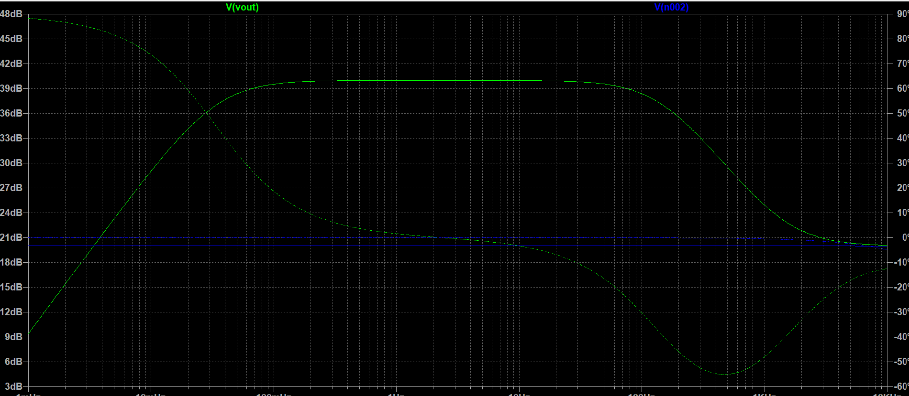
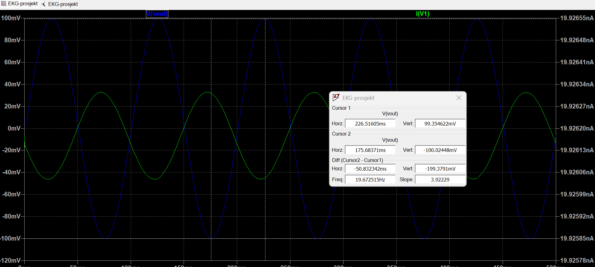

# ecg-amplifier-ina126-tlc07
2-stage analog ECG front-end (INA126 instrumentation amplifier + TLC071 active bandpass filter, 100x / 40 dB gain, 0.034 Hz – 147 Hz) simulated in LTspice.

# Analog ECG Front-End (INA126 + TLC071) – LTspice Simulation

A 2-stage analog electrocardiogram (ECG) signal conditioning front-end designed and simulated in **LTspice XVII**. The circuit amplifies weak differential biopotential signals (`~1 mV`) by **100× (`40 dB`)** while filtering out DC skin-electrode offset and high-frequency noise.

## Circuit Architecture

1. **Stage 1 – Instrumentation Amplifier (`INA126`)**
   * High input impedance differential amplification of the raw ECG signal.
   * Gain resistor $R_G = 16\text{ k}\Omega$ placed between pins 1 and 8:
     $$G_1 = 5 + \frac{80\text{ k}\Omega}{R_G} = 5 + \frac{80\text{ k}\Omega}{16\text{ k}\Omega} = 10\text{ V/V } (20\text{ dB})$$

2. **Stage 2 – Active Bandpass Filter (`TLC071`)**
   * **High-pass stage:** $C_1 = 4.7\ \mu\text{F}$, $R_1 = 680\text{ k}\Omega$ ($f_{c,\text{low}} \approx 0.05\text{ Hz}$) to remove baseline wander and DC offset.
   * **Low-pass & gain stage:** $R_f = 100\text{ k}\Omega$, $R_{\text{in}} = 10\text{ k}\Omega$, $C_2 = 100\text{ nF}$ ($f_{c,\text{high}} \approx 159\text{ Hz}$) with a passband gain of:
     $$G_2 = \frac{R_f}{R_{\text{in}}} = \frac{100\text{ k}\Omega}{10\text{ k}\Omega} = 10\text{ V/V } (20\text{ dB})$$

3. **Total System Performance**
   * **Total Passband Gain:** $G_{\text{total}} = G_1 \times G_2 = 100\text{ V/V } (40\text{ dB})$
   * **Simulated Transient Response (`1 mV` peak, `10 Hz` sine):** `199.3 mVpp` output (`~99.7×` verified gain).

## Simulation Results

### AC Frequency Response (`40 dB` Passband)

### Transient Measurement (`1 mV` Input -> `100 mV` Output)

## Repository Files

* `EKG-prosjekt.asc` – Main LTspice schematic file.
* `EKG-prosjekt.plt` – Saved waveform plot configuration.
* `INAx126.LIB` & `INAx126.asy` – Texas Instruments SPICE model and symbol for `INA126`.
* `TLC071.MOD` – Texas Instruments SPICE model for `TLC071`.
